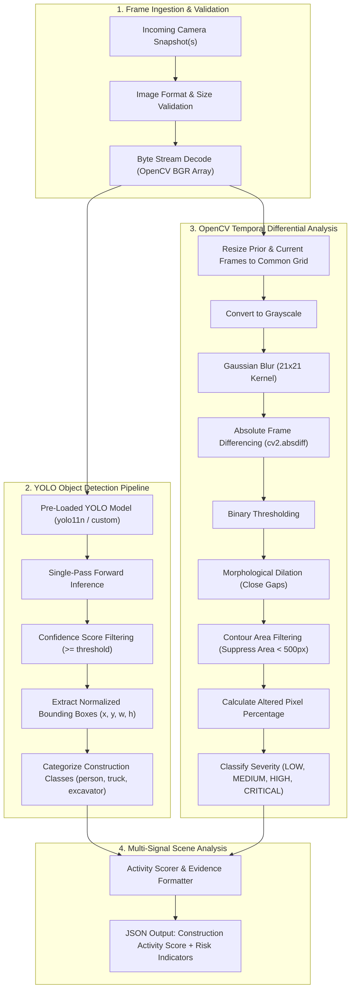

# Computer Vision & Scene Intelligence Design Document

This document provides a technical overview of the Computer Vision subsystem in **ConstructGuard**, explaining the deep learning object detection pipeline, OpenCV differential image processing, algorithmic trade-offs, and failure mode mitigations.

---

## 1. Computer Vision Architecture (Mermaid)



---

## 2. Object Detection with YOLO

### 2.1 YOLO Architecture at a High Level
YOLO ("You Only Look Once") frames object detection as a single regression problem directly from full image pixels to bounding box coordinates and class probabilities. Unlike two-stage detectors (e.g. Faster R-CNN) that first generate candidate region proposals via a Region Proposal Network (RPN) and subsequently classify each proposal, YOLO passes the image through a single unified convolutional neural network (CSPDarknet backbone with PANet/FPN path aggregation necks). This eliminates redundant feature recomputations.

### 2.2 Why YOLO is Appropriate for ConstructGuard
1. **Low Inference Latency**: At standard resolutions (640x640), lightweight models like `yolo11n` or `yolov8n` run in 15–45 ms on CPU and <10 ms on GPU, making high-throughput asynchronous processing feasible across fleets of cameras.
2. **Global Context**: Because the network evaluates the entire frame simultaneously, it encodes contextual information about classes and their appearance, resulting in fewer background false positives compared to sliding-window or region-proposal techniques.
3. **Single Startup Allocation**: Loading the model weights once during the FastAPI application lifespan avoids allocating GPU/CPU memory per HTTP request.

### 2.3 Object Detection Workflow
1. Camera frame bytes are validated and decoded into an OpenCV BGR NumPy matrix.
2. The image is passed to `Detector.detect()`.
3. Non-Maximum Suppression (NMS) suppresses overlapping duplicate candidate bounding boxes.
4. Bounding boxes meeting the confidence threshold are normalized into pixel coordinates `{x, y, width, height}`.
5. Clean Pydantic `Detection` objects are constructed and returned.

### 2.4 Confidence Threshold
The confidence score reflects the model's certainty that a bounding box encloses an object of the predicted class:
$$\text{Score} = P(\text{Object}) \times \text{IoU}_{\text{pred},\text{truth}}$$
We use a configurable threshold (default `0.40`). Detections below this cutoff are filtered out to suppress low-certainty noise.

### 2.5 Bounding Boxes
Each bounding box is converted into standard Cartesian pixel coordinates:
- `x`: Top-left horizontal coordinate
- `y`: Top-left vertical coordinate
- `width`: Box width in pixels
- `height`: Box height in pixels

---

## 3. OpenCV Image Differential Analysis

### 3.1 OpenCV Image Differencing
While object detection tells us *what* objects are in a frame, it does not reveal physical site modifications (e.g., digging, concrete pouring, wall assembly). OpenCV frame differencing provides an independent, computationally lightweight verification by quantifying structural and spatial alterations between consecutive camera observations.

### 3.2 Gaussian Blur
Environmental camera feeds constantly capture micro-fluctuations: tree leaves rustling, sensor thermal noise, compression artifacts, and minor sunlight changes. Passing frames through a **Gaussian Blur** with an odd kernel size (e.g., $21 \times 21$) acts as a low-pass filter, attenuating high-frequency noise while preserving prominent macroscopic structural edges.

### 3.3 Thresholding
After computing the absolute difference between smoothed grayscale frames:
$$\Delta(x, y) = |I_{\text{curr}}(x, y) - I_{\text{prev}}(x, y)|$$
We apply binary thresholding with cutoff value $T = 30$:
$$\text{Pixel}_{\text{thresh}}(x, y) = \begin{cases} 255 & \text{if } \Delta(x, y) \ge 30 \\ 0 & \text{otherwise} \end{cases}$$
This isolates pixels where physical brightness has substantially changed.

### 3.4 Morphological Operations
Binary thresholding often leaves fragmented, hollow edges. We apply morphological **dilation** with a rectangular structuring element ($5 \times 5$, 2 iterations). Dilation expands white boundaries, bridging disconnected pixel clusters into continuous masks representing coherent physical objects.

### 3.5 Contour Filtering
Using `cv2.findContours`, connected altered regions are outlined. To prevent transient environmental artifacts (passing birds, windblown debris, minor sun shadows) from triggering false alerts, each contour's area is evaluated against a configurable `min_contour_area` (default: 500 square pixels). Contours below this threshold are discarded.

### 3.6 Change Percentage & Classification
The overall altered pixel percentage is computed across the total image area:
$$\text{Change \%} = \left( \frac{\sum \text{Changed Pixels}}{\text{Total Pixels}} \right) \times 100$$
The result is categorized into four configurable severity bands:
- **LOW**: $0\% - 10\%$ (minor adjustments, stationary scene)
- **MEDIUM**: $10\% - 25\%$ (notable equipment movement or delivery)
- **HIGH**: $25\% - 50\%$ (significant structural alteration or earthwork)
- **CRITICAL**: $> 50\%$ (major site transformation, massive earth excavation)

---

## 4. Limitations, Edge Cases & Failure Modes

### 4.1 Pretrained Model Limitations
Standard pretrained YOLO checkpoints (e.g. trained on MS COCO 80 categories) natively detect general classes: `person`, `truck`, `car`, `bus`. They do not include dedicated classes for specialized earthmoving machines such as `excavator`, `crane`, or `concrete_mixer`. When a pretrained COCO checkpoint is loaded, heavy machinery may be detected as `truck` or `bus`. The architecture is deliberately configured so that setting `MODEL_NAME=custom_construction.pt` seamlessly swaps in a custom fine-tuned model without code modifications.

### 4.2 False Positives
- **Sudden Illumination Shifts**: Rapid cloud clearance or artificial stadium site lights can trigger visual change false positives. Mitigated by high Gaussian blur, minimum contour thresholds, and fusing visual change with object presence.
- **Occluded Stationary Vehicles**: A parked delivery van may be flagged repeatedly. Mitigated by temporal change comparison (stationary vehicles produce 0% change).

### 4.3 False Negatives
- **Nighttime Low-Light Imagery**: Cameras without infrared (IR) illuminators produce underexposed, noisy frames where object contours blend into darkness. Mitigated in subsequent phases by pairing camera frames with IoT ground vibration and acoustic sensors.
- **Long-Distance Perspective**: Machinery far in the background may occupy fewer than 16 pixels. Mitigated by camera resolution requirements and zoom framing.

### 4.4 Future Custom Model Training
To move beyond generic COCO classes, a custom dataset (e.g. SOHAS or MOCS Construction Machinery Dataset) labeled with `[excavator, dump_truck, tower_crane, bulldozer, worker_vest, worker_helmet]` can be trained using Ultralytics CLI:
```bash
yolo detect train data=construction.yaml model=yolo11n.pt epochs=100 imgsz=640
```
The resulting `best.pt` file is simply configured in `.env` as `MODEL_NAME=./weights/best.pt`.

---

## 5. Performance Measurement

Performance is benchmarked using `benchmarks/benchmark_detection.py`, which records:
- **Average Latency**: Mean end-to-end inference and diff pipeline time per frame.
- **Minimum & Maximum Latency**: Jitter bounds.
- **P95 Latency**: 95th-percentile response time under load.
- **Throughput**: Measured frames processed per second.
