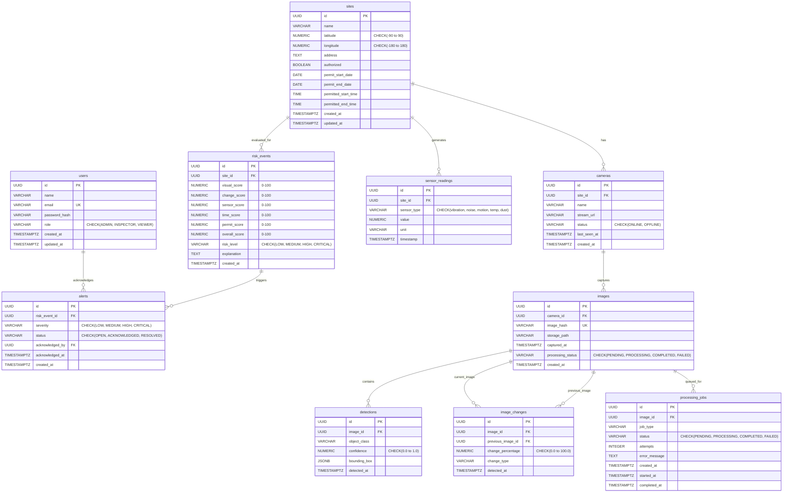

# ConstructGuard Database Architecture Design Document

This document details the relational data model for the **ConstructGuard** platform, covering schema definitions, constraints, indexing strategies, architectural rationale for PostgreSQL, and storage decisions.

---

## 1. Entity-Relationship Diagram (Mermaid)

---

## 2. Table Specifications & Relationships

### 2.1 `users`
- **Purpose**: System identity management with Role-Based Access Control (RBAC).
- **Key Columns**: `id` (UUID PK), `email` (Unique), `role` (`ADMIN`, `INSPECTOR`, `VIEWER`).

### 2.2 `sites`
- **Purpose**: Physical construction parcels subject to municipal surveillance and permit limits.
- **Key Columns**: `latitude`/`longitude` with geographical coordinate range checks (`[-90, 90]`, `[-180, 180]`), `authorized` flag, and temporal permit boundaries (`permit_start_date`, `permit_end_date`, `permitted_start_time`, `permitted_end_time`).

### 2.3 `cameras`
- **Purpose**: Physical or RTSP edge cameras mounted per construction site.
- **Key Columns**: `site_id` (FK to `sites`), `stream_url`, `status` (`ONLINE`, `OFFLINE`), and heartbeat timestamp (`last_seen_at`).

### 2.4 `sensor_readings`
- **Purpose**: High-frequency time-series telemetry from IoT hardware perimeter sensors.
- **Key Columns**: `site_id` (FK), `sensor_type` (`vibration`, `noise`, `motion`, `temperature`, `dust`), `value`, `unit`, and `timestamp`.

### 2.5 `images`
- **Purpose**: Audit log of snapshot frames received from site cameras.
- **Key Columns**: `camera_id` (FK), `image_hash` (SHA-256 unique digest), `storage_path` (Object storage URI), `processing_status`.

### 2.6 `detections`
- **Purpose**: Computer vision object detections generated by YOLO.
- **Key Columns**: `image_id` (FK), `object_class` (`excavator`, `worker`, `truck`, `crane`), `confidence` (`0.00` to `1.00`), `bounding_box` (`JSONB` storing `{x, y, width, height}`).

### 2.7 `image_changes`
- **Purpose**: OpenCV morphological and pixel difference comparisons between successive frames.
- **Key Columns**: `image_id` (FK), `previous_image_id` (FK to prior observation), `change_percentage` (`0.0%` to `100.0%`), and `change_type`.

### 2.8 `risk_events`
- **Purpose**: Evaluated multi-signal intelligence outcomes produced by the Risk Engine.
- **Key Columns**: Sub-scores (`visual_score`, `change_score`, `sensor_score`, `time_score`, `permit_score`), `overall_score` (`0–100`), `risk_level` (`LOW`, `MEDIUM`, `HIGH`, `CRITICAL`), and human-readable `explanation`.

### 2.9 `alerts`
- **Purpose**: Actionable incidents dispatched to operators requiring inspection or triage.
- **Key Columns**: `risk_event_id` (FK), `severity`, `status` (`OPEN`, `ACKNOWLEDGED`, `RESOLVED`), `acknowledged_by` (FK to `users`), `acknowledged_at`.

### 2.10 `processing_jobs`
- **Purpose**: Queue audit trail tracking execution state of asynchronous BullMQ workers.
- **Key Columns**: `image_id` (FK), `job_type`, `status` (`PENDING`, `PROCESSING`, `COMPLETED`, `FAILED`), retry `attempts`, and execution error traces.

---

## 3. Indexing Strategy & Performance Rationale

| Index Name | Table & Target Columns | Rationale & Query Pattern |
|---|---|---|
| `idx_sites_authorized` | `sites(authorized)` | Fast filtering of unauthorized or expired parcels across city dashboards. |
| `idx_cameras_site_id` | `cameras(site_id)` | Efficient join when fetching all cameras associated with an inspected site. |
| `idx_sensor_readings_site_timestamp` | `sensor_readings(site_id, timestamp DESC)` | **Composite index** optimizing time-series range lookups (e.g. recent 15-minute sensor window for anomaly detection). |
| `idx_images_image_hash` | `images(image_hash)` | **O(1) hash collision lookup** to guarantee deduplication and idempotent ingestion before enqueueing image jobs. |
| `idx_detections_image_id` | `detections(image_id)` | Speeds up retrieval of bounding boxes rendered over a selected camera frame. |
| `idx_risk_events_site_id` | `risk_events(site_id)` | Powers site-specific historical risk trend analytics. |
| `idx_risk_events_created_at` | `risk_events(created_at DESC)` | Accelerates daily risk queries and chronologically ordered audit logs. |
| `idx_risk_events_risk_level` | `risk_events(risk_level)` | Instant filtering for CRITICAL/HIGH risk events across the municipality. |
| `idx_alerts_status` | `alerts(status)` | Powers operator triage query: `SELECT * FROM alerts WHERE status = 'OPEN'`. |
| `idx_processing_jobs_status` | `processing_jobs(status)` | Monitored by worker supervisors to quickly detect stuck or failed jobs. |

---

## 4. Integrity Constraints

1. **Primary & Foreign Keys**: All tables enforce UUID primary keys using `gen_random_uuid()` with `ON DELETE CASCADE` on child entities (or `ON DELETE SET NULL` for non-critical joins like prior images or job images).
2. **Value Boundaries (`CHECK`)**:
   - Geocoordinates bounded strictly to Earth limits: `latitude BETWEEN -90 AND 90`, `longitude BETWEEN -180 AND 180`.
   - Confidence bounded between `0.0` and `1.0`.
   - Risk sub-scores and overall score bounded between `0.0` and `100.0`.
   - Enums enforced at the database level (`role`, `status`, `sensor_type`, `risk_level`, `severity`).
3. **Idempotency & Deduplication (`UNIQUE`)**:
   - `images(image_hash)`: Guarantees that duplicate camera frames with the same cryptographic SHA-256 fingerprint cannot be enqueued or processed twice.

---

## 5. Architectural Discussion (Interview Focus)

### Why PostgreSQL?
1. **Relational Integrity**: The domain model has strictly structured entities (`Site -> Cameras -> Images -> Detections -> Risk Events -> Alerts`). Referential constraints prevent orphaned sensor logs or phantom alerts.
2. **ACID Transactions**: Alert generation and job completion involve coordinated multi-table writes (`risk_events`, `alerts`, `processing_jobs`). Transactions ensure atomicity.
3. **JSONB Flexibility**: Bounding boxes and flexible model metadata are stored inside PostgreSQL using `JSONB`, providing schema flexibility without losing relational query power.
4. **Time-Series Indexing**: PostgreSQL B-tree composite indexes (`site_id, timestamp DESC`) deliver sub-millisecond range queries over millions of IoT telemetry points.

### Why Store Image Metadata in PostgreSQL Rather Than Raw Binary Blobs?
- **Database Bloat Prevention**: Construction cameras generate thousands of megabytes of frames daily. Storing raw binary data (`BYTEA`) inside PostgreSQL causes rapid database bloat, degrades buffer cache hit ratios, and makes WAL backups slow.
- **Decoupled Architecture**: Images are stored in an Object Storage layer (e.g. AWS S3, MinIO, or local disk volume). Only the **immutable metadata** (`storage_path`, `image_hash`, `camera_id`, `captured_at`) is persisted in PostgreSQL.
- **Cost & Throughput Efficiency**: Object storage handles high-throughput media streaming via CDN presigned URLs, offloading database connection pools.
