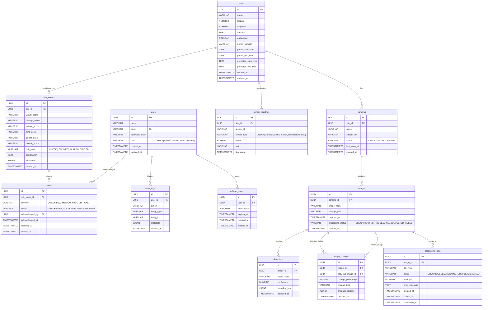

# ConstructGuard Database Architecture Specification

## Overview
ConstructGuard leverages **PostgreSQL 16** with strict relational integrity, UUID primary keys, specialized JSONB payloads for computer-vision and IoT anomalies, and indexed query patterns.

---

## 1. Entity-Relationship Model (Mermaid)

---

## 2. Key Database Indexes
- `idx_sites_auth_dates`: Optimizes temporal permit checks.
- `idx_sensor_readings_site_type_ts`: Fast time-window telemetry aggregations (`site_id`, `sensor_type`, `timestamp DESC`).
- `idx_risk_events_site_created`: Rapid risk trend calculations (`site_id`, `created_at DESC`).
- `idx_alerts_status_severity`: Live triage operator queries (`status`, `severity`, `created_at DESC`).
- `idx_detections_image`: Fast lookup of bounding box items per captured frame.
- `idx_processing_jobs_status`: BullMQ worker idempotency and retry queue lookups.
- `idx_refresh_tokens_hash`: Quick token revocation and rotation lookups.
