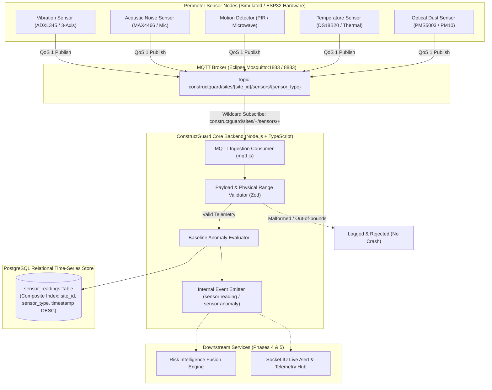
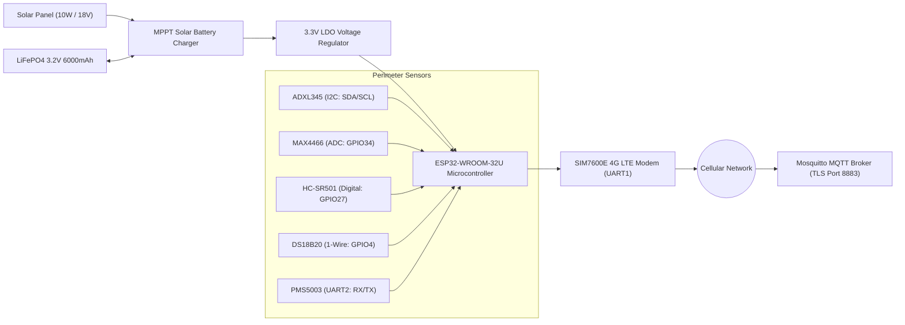

# ConstructGuard — IoT Telemetry & MQTT Ingestion Architecture

This document specifies the IoT perimeter telemetry ingestion subsystem for the **ConstructGuard Smart Unauthorized Construction Monitoring Platform**. It details the physical/simulated sensor layer, message broker architecture, payload validation, PostgreSQL time-series indexing, fault-tolerance mechanisms, and production edge hardware deployment (ESP32).

---

## 1. Subsystem Architecture

The IoT subsystem is decoupled from the core REST and Computer Vision services using a **Publish-Subscribe architecture** powered by an **Eclipse Mosquitto** MQTT broker.



---

## 2. Why MQTT Was Selected Over HTTP Polling and WebSockets

Construction site monitoring imposes unique physical and network constraints:

| Evaluation Criteria | MQTT (Selected) | HTTP REST Ingestion | Raw WebSockets |
| :--- | :--- | :--- | :--- |
| **Transport Overhead** | **Ultra-lightweight** (2-byte fixed header). Minimizes cellular data usage. | **Heavy** (500–1000 bytes per request with HTTP headers, cookies, TLS renegotiation). | **Moderate** (framing header is small, but initial HTTP handshake is heavy). |
| **Network Resilience** | Built for **intermittent connectivity**, high packet loss, cellular 4G/LTE, and LoRaWAN gateways. | Fails on intermittent drops; requires custom retry loops and connection pooling on microcontroller. | Persistent TCP connection drops frequently across changing cellular towers. |
| **Decoupling** | **Full Pub/Sub decoupling**. Sensor nodes do not know backend IP addresses or database topology. | Point-to-point. Nodes must know backend URL and handle HTTP status codes. | Point-to-point. Requires bidirectional full-duplex socket handling. |
| **Battery Life (MCU)** | Highly efficient with sleep modes; lightweight TCP connect/publish/disconnect or keepalive. | High power drain due to repetitive TCP handshakes and TLS session negotiation. | High power drain keeping full-duplex socket open continuously. |
| **Quality of Service (QoS)** | **Built-in guarantees** (QoS 0: At most once, QoS 1: At least once, QoS 2: Exactly once). | Application must manually implement ACKs and idempotency keys. | Application must implement manual ACK framing. |
| **Device Health (LWT)** | **Last Will and Testament (LWT)** automatically notifies subscribers when a node drops offline abruptly. | Requires periodic heartbeat polling and timeout timers on server. | Requires custom ping/pong application logic. |

---

## 3. Standardized Topic Hierarchy

All telemetry messages follow a strict hierarchical namespace:

```text
constructguard/sites/{site_id}/sensors/{sensor_type}
```

### Examples:
* `constructguard/sites/site-101/sensors/vibration`
* `constructguard/sites/site-101/sensors/noise`
* `constructguard/sites/site-101/sensors/motion`
* `constructguard/sites/site-101/sensors/temperature`
* `constructguard/sites/site-101/sensors/dust`

### Wildcard Subscription:
The Node.js backend consumer subscribes using standard MQTT multi-level wildcards:
```text
constructguard/sites/+/sensors/+
```
This enables ingesting telemetry from all monitored sites and all sensor types through a single multiplexed channel without requiring per-site configuration changes.

---

## 4. Telemetry Payload Specification

All published payloads must be strictly formatted JSON with UTC ISO-8601 timestamps:

```json
{
  "site_id": "site-101",
  "sensor_id": "vib-101",
  "sensor_type": "vibration",
  "value": 0.82,
  "unit": "g",
  "timestamp": "2026-10-08T10:30:00.000Z"
}
```

### Sensor Types, Units, and Boundaries

| Sensor Type | Physical Metric | Unit | Normal Demonstration Range | Simulated Anomalous Range | Hardware Physical Boundary Filter |
| :--- | :--- | :--- | :--- | :--- | :--- |
| `vibration` | Ground acceleration / seismic force | `g` | `0.05 – 0.25 g` | `0.70 – 1.20 g` (excavators, pile drivers) | `0.0 <= value <= 10.0` |
| `noise` | Ambient acoustic pressure | `dB` | `40.0 – 65.0 dB` | `80.0 – 110.0 dB` (jackhammers, generators) | `0.0 <= value <= 200.0` |
| `motion` | Perimeter infrared / radar trip | `state` | `0.0` (idle), rare `1.0` | `1.0` continuous (unauthorized movement) | `0.0` or `1.0` |
| `temperature` | Ambient perimeter heat | `C` | `20.0 – 35.0 C` | `45.0 – 60.0 C` (running diesel exhaust) | `-50.0 <= value <= 150.0` |
| `dust` | Particulate concentration (PM10) | `ug/m3`| `10.0 – 40.0 ug/m3`| `70.0 – 150.0 ug/m3` (demolition / excavation) | `0.0 <= value <= 1000.0` |

> [!NOTE]
> The baseline anomaly thresholds are configurable demonstration values for risk fusion, not statutory regulatory compliance claims.

---

## 5. Resilience & Fault Tolerance

1. **Broker Downtime Isolation**:
   * If the MQTT broker stops or restarts, the Node.js backend **does not crash**.
   * The `MQTTClientManager` automatically triggers reconnect loops every 3,000ms with linear backoff.
   * `GET /api/health` reports status as `{ "status": "degraded", "database": "connected", "mqtt": "disconnected" }` with HTTP 200, allowing web APIs and health probes to remain functional.
2. **Defensive Validation (Fail-Safe Ingestion)**:
   * Every incoming MQTT payload passes through:
     1. Topic regex structure verification
     2. JSON syntax parse safety (`try/catch`)
     3. Zod schema validation (type checks, finite numbers, ISO timestamp)
     4. Sensor physical boundary validation
     5. Site identifier resolution against PostgreSQL (`sites.id` UUID or `sites.code`)
   * Any malformed or out-of-bounds message is safely rejected and logged with a structured warning without throwing uncaught exceptions.
3. **IoT Simulator Auto-Recovery**:
   * Python `MQTTPublisher` utilizes Paho MQTT client loops with `reconnect_delay_set(1, 30)` to recover automatically whenever Mosquitto restarts.

---

## 6. PostgreSQL Database Indexing Strategy

High-frequency IoT sensor telemetry generates high row volumes (e.g., 5 sensors × 5 sites × 12 samples/min = 18,000 rows/hour).

To ensure instant API response times without performing sequential table scans, the schema employs targeted B-tree indexing:

```sql
-- 1. High-Performance Composite Index for Time-Series Queries
CREATE INDEX idx_sensor_readings_site_type_time 
ON sensor_readings(site_id, sensor_type, timestamp DESC);

-- 2. Lookup Indexes
CREATE INDEX idx_sensor_readings_site_id ON sensor_readings(site_id);
CREATE INDEX idx_sensor_readings_sensor_type ON sensor_readings(sensor_type);
CREATE INDEX idx_sensor_readings_timestamp ON sensor_readings(timestamp DESC);
CREATE INDEX idx_sensor_readings_sensor_id ON sensor_readings(sensor_id);
```

### Why the Composite Index Matters:
The query executed by `GET /api/sites/:id/sensors?sensor_type=vibration&limit=50`:
```sql
SELECT id, site_id, sensor_id, sensor_type, value, unit, timestamp 
FROM sensor_readings 
WHERE site_id = $1 AND sensor_type = $2 
ORDER BY timestamp DESC 
LIMIT $3;
```
Because `site_id`, `sensor_type`, and `timestamp DESC` match the index ordering exactly, PostgreSQL performs an **Index Scan**, locating the latest 50 rows in sub-millisecond time without sorting rows in memory.

### Fast "Latest Per Type" Query (`DISTINCT ON`):
`GET /api/sites/:id/sensors/latest` leverages PostgreSQL's optimized `DISTINCT ON`:
```sql
SELECT DISTINCT ON (sensor_type) 
  id, site_id, sensor_id, sensor_type, value, unit, timestamp
FROM sensor_readings
WHERE site_id = $1
ORDER BY sensor_type, timestamp DESC;
```
This gathers the single most recent reading for each sensor type in a single database round-trip.

---

## 7. Real Hardware Deployment Guide (ESP32 Edge Node)

To deploy physical sensor perimeter units at real construction sites:



### Hardware Components:
1. **Compute**: ESP32-WROOM-32U (Dual-core 240MHz, 520KB SRAM, deep-sleep capable).
2. **Connectivity**: SIMCOM SIM7600E 4G LTE module (PPP or AT command MQTT) with external high-gain antenna, or long-range outdoor Wi-Fi.
3. **Sensors**:
   * **Vibration**: ADXL345 digital 3-axis accelerometer connected via I2C (`0x53`). Measures earth vibration in g-units.
   * **Noise**: MAX4466 electret microphone amplifier connected to ESP32 12-bit ADC (`GPIO34`). MCU samples at 8kHz, computes RMS amplitude, and maps to dB SPL.
   * **Motion**: RCWL-0516 microwave Doppler radar sensor connected to `GPIO27` (penetrates rain and dust better than standard optical PIR).
   * **Temperature**: DS18B20 waterproof digital 1-Wire probe (`GPIO4`).
   * **Dust**: Plantower PMS5003 laser particulate sensor connected via UART2 (`GPIO16/GPIO17`). Measures PM2.5 and PM10 concentrations in µg/m³.
4. **Power System**: 10W monocrystalline solar panel + TP5000 LiFePO4 battery management board + 3.2V 6000mAh battery. The ESP32 enters lightweight modem-sleep between 5-second sampling cycles to maintain 24/7 continuous perimeter vigilance.
5. **Firmware Implementation**: C++/Arduino using `PubSubClient` or Espressif ESP-IDF `esp-mqtt` with TLS certificate authentication.
