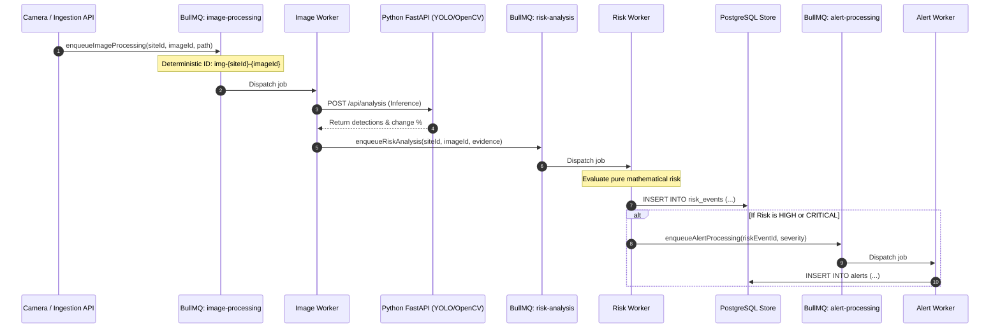

# ConstructGuard — BullMQ Distributed Queue Architecture

This document specifies the asynchronous distributed job processing pipeline powered by **BullMQ** and **Redis 7** for **ConstructGuard**.

---

## 1. Asynchronous Processing Pipeline

To guarantee sub-second HTTP API responses and absorb traffic surges from multiple cameras across construction sites, all heavy workloads are decoupled into asynchronous queues.



---

## 2. Queues & Workers Directory Structure

```text
backend/src/
├── queues/
│   ├── queue.ts                    # Central queue factory, connection options & defaults
│   ├── imageProcessingQueue.ts     # 'image-processing' queue & enqueueImageProcessing()
│   ├── riskAnalysisQueue.ts        # 'risk-analysis' queue & enqueueRiskAnalysis()
│   ├── alertQueue.ts               # 'alert-processing' queue & enqueueAlertProcessing()
│   └── index.ts                    # Barrel exports
└── workers/
    ├── imageProcessing.worker.ts   # Runs CV inference & forwards to risk queue
    ├── riskAnalysis.worker.ts      # Computes risk score, persists risk_events & alerts
    ├── alert.worker.ts             # Persists operator alerts
    └── index.ts                    # Central worker lifecycle manager
```

---

## 3. Reliability & Retry Strategy

Every queue applies deterministic reliability defaults:

```typescript
export const defaultJobOptions: JobsOptions = {
  attempts: 3,
  backoff: {
    type: 'exponential',
    delay: 2000, // 2s -> 4s -> 8s
  },
  removeOnComplete: { count: 1000 },
  removeOnFail: { count: 5000 },
};
```

1. **Exponential Backoff**:
   * Attempt 1: Immediate execution.
   * Attempt 2 (after failure): Retried after 2 seconds ($2000 \times 2^0$).
   * Attempt 3: Retried after 4 seconds ($2000 \times 2^1$).
   * Attempt 4: Retried after 8 seconds ($2000 \times 2^2$).
   * Does not retry indefinitely; after 3 failed attempts, moves to failed state for dead-letter auditing.
2. **Crash Resilience**:
   * If a Node.js process crashes mid-job, BullMQ's Redis lock expires and the job is automatically returned to the waiting queue for another worker to resume.
3. **Memory Bounding**:
   * Successful jobs are trimmed after 1,000 completed records.
   * Failed jobs are retained up to 5,000 records for diagnostic review.
4. **Redis Storage Discipline**:
   * Binary images and heavy raw frames are **never stored in Redis**.
   * Only lightweight metadata (UUIDs, file storage paths, timestamps, numeric scores) is persisted in Redis memory.

---

## 4. Idempotency & Deduplication

In surveillance environments, camera network glitches can cause duplicate HTTP uploads of the same frame. ConstructGuard prevents duplicate risk events using **deterministic BullMQ Job IDs**:

| Queue | Deterministic Job ID Format | Deduplication Effect |
| :--- | :--- | :--- |
| `image-processing` | `img-{siteId}-{imageId}` | If the same image upload is retried, BullMQ rejects the duplicate submission. |
| `risk-analysis` | `risk-{siteId}-{imageId}` | Prevents creating multiple duplicate risk events for the same captured snapshot. |
| `alert-processing` | `alert-{riskEventId}` | Guarantees that only a single operator alert is created per risk event. |

---

## 5. Structured Worker Observability

All workers log structured JSON telemetry via Pino:

```json
{
  "level": 30,
  "time": 1791437145000,
  "event": "risk_analysis_completed",
  "jobId": "risk-site-101-img-456",
  "jobType": "risk-analysis",
  "siteId": "site-101",
  "riskEventId": "e1a2b3c4-...",
  "overallScore": 74.5,
  "riskLevel": "HIGH",
  "durationMs": 38,
  "status": "completed"
}
```

---

## 6. Graceful Lifecycle Integration

When `SIGINT` or `SIGTERM` signals are received:
1. HTTP server stops accepting new connections.
2. `workerManager.stop()` completes active in-flight jobs and pauses queue consumers.
3. Redis client connection is closed with `closeRedis()`.
4. MQTT client disconnects cleanly.
5. PostgreSQL database pool drains all open connections.
