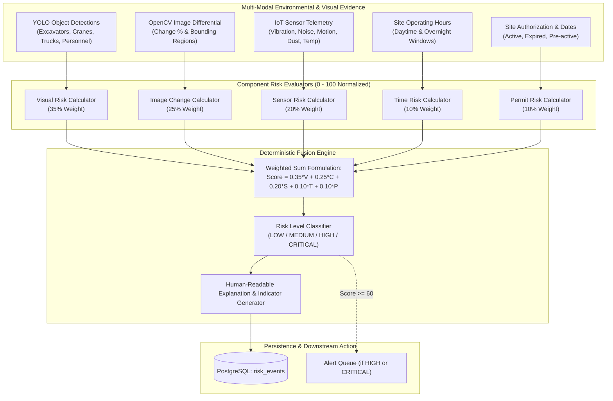

# ConstructGuard — Risk Intelligence Engine Architecture

This document specifies the deterministic **Risk Intelligence Engine** subsystem for **ConstructGuard Smart Unauthorized Construction Monitoring & Risk Assessment Platform**. It details the mathematical fusion formula, component risk calculators, sensor anomaly weighting, missing data resilience, temporal overnight schedule evaluation, and human-readable explanation generation.

---

## 1. Risk Intelligence Overview

Rather than relying on non-deterministic or opaque LLM generation, ConstructGuard employs a **pure, deterministic, and explainable multi-factor risk fusion engine**.

> [!NOTE]
> **Legal Disclaimer Compliance**: The ConstructGuard system does not assert legal proof of unlawful activity. All explanations and indicators explicitly characterize findings as *"potentially unauthorized construction activity requiring human inspection."*

---

## 2. Mathematical Scoring Formula

The overall risk score is calculated via normalized linear combination:

$$\text{OverallScore} = 0.35 \cdot S_{\text{visual}} + 0.25 \cdot S_{\text{change}} + 0.20 \cdot S_{\text{sensor}} + 0.10 \cdot S_{\text{time}} + 0.10 \cdot S_{\text{permit}}$$

* All component scores $S_i$ are normalized to the range $[0, 100]$.
* The final score is rounded to two decimal places.

### Component Weight Breakdown

| Component | Weight | Rationale |
| :--- | :---: | :--- |
| **Visual Evidence** | **35%** | Direct visual identification of heavy machinery (excavator, crane, truck) is the highest-confidence physical evidence of active construction. |
| **Image Change Delta** | **25%** | Structural modifications, earthmoving, or terrain disturbances indicate physical progress on site. |
| **IoT Sensor Telemetry** | **20%** | Seismic vibration, demolition noise, and airborne dust corroborate physical machinery operation. |
| **Time of Day** | **10%** | Activity outside permitted operational windows (e.g. night-time violations) elevates unauthorized risk. |
| **Permit & Authorization** | **10%** | Unpermitted or expired sites amplify unauthorized operational risk. |

---

## 3. Risk Level Classifications

The final score maps into four operational tiers:

| Score Range | Severity Level | Operational Meaning | Action Required |
| :---: | :---: | :--- | :--- |
| **0 – 29.99** | `LOW` | Normal site baseline conditions. Routine environmental drift. | Standard automated logging. No alerts triggered. |
| **30 – 59.99** | `MEDIUM` | Minor changes, isolated sensor spikes, or routine personnel movement. | Surveillance advisory. Included in daily inspector digest. |
| **60 – 79.99** | `HIGH` | Corroborated equipment activity, significant visual delta, or out-of-hours operation. | **Immediate inspection required**. Alert enqueued. |
| **80 – 100.00** | `CRITICAL` | Severe multi-sensor surge + heavy machinery + expired permit or unauthorized site. | **Emergency alert**. Priority inspector dispatch. |

---

## 4. Component Calculators Detail

### 4.1 Visual Risk (`visualRisk.ts`)
Calculates an activity score based on detected object classes and confidence scores:
* Excavator: 70
* Crane / Bulldozer: 65
* Heavy Machinery: 50
* Truck: 45
* Worker / Personnel: 25–30
* Car: 15
* Formula: $\text{Score} = \min\left(100, \sum \text{Weight}_i \times \text{Confidence}_i\right)$
* Identifies indicators: `HEAVY_MACHINERY_DETECTED`, `TRUCK_DETECTED`, `PERSONNEL_DETECTED`, `MULTIPLE_CONSTRUCTION_OBJECTS`.

### 4.2 Image Change Risk (`changeRisk.ts`)
Converts the OpenCV structural delta percentage into a 0–100 score:
* **0% – 5%**: Low risk (maps $0 \to 25$). Indicator: `LOW_IMAGE_CHANGE`
* **5% – 15%**: Moderate risk (maps $25 \to 55$). Indicator: `MODERATE_IMAGE_CHANGE`
* **15% – 30%**: Significant risk (maps $55 \to 85$). Indicator: `HIGH_IMAGE_CHANGE`
* **> 30%**: Critical transformation (maps $85 \to 100$). Indicator: `CRITICAL_IMAGE_CHANGE`
* Preserves `changeType` (e.g., `STRUCTURAL_ADDITION`) and bounding boxes of changed regions.

### 4.3 IoT Sensor Risk (`sensorRisk.ts`)
Employs normalized weighting across 5 physical sensor metrics:
* Vibration: 0.30
* Noise: 0.20
* Motion: 0.20
* Dust: 0.20
* Temperature: 0.10

**Multi-Anomaly Scaling**:
* Single anomaly: moderate score ($1.0 \times$).
* Two simultaneous anomalies: compound multiplier ($1.35 \times$). Indicator: `MULTIPLE_SENSOR_ANOMALIES`.
* Three or more simultaneous anomalies: severe surge multiplier ($1.65 \times$). Indicator: `SEVERE_MULTI_SENSOR_SURGE`.

**Missing Sensor Data Resilience**:
* Unavailable sensors are excluded from the calculation, and weights of remaining sensors are dynamically re-normalized.
* Missing sensors do **NOT** artificially inflate the risk score.
* The indicator `MISSING_SENSOR_DATA` is emitted to inform inspectors of sensor gaps.

### 4.4 Temporal Risk (`timeRisk.ts`)
Evaluates current observation time against site operating schedules:
* **Inside permitted hours**: Score = 0
* **Outside permitted hours**: Score = 80 (configurable). Indicator: `OUTSIDE_PERMITTED_HOURS`
* **Overnight Windows**: Handles schedules spanning midnight (e.g., `22:00` to `06:00`). Correctly marks 23:30 and 04:00 as inside hours, and 14:00 as outside hours.
* **Missing Schedule**: Score = 30 (neutral). Indicator: `PERMIT_SCHEDULE_UNAVAILABLE`.

### 4.5 Permit & Authorization Risk (`permitRisk.ts`)
Assesses site regulatory standing:
* **Authorized with Active Permit**: Score = 0
* **Unauthorized Site**: Score = 95. Indicator: `UNAUTHORIZED_SITE`
* **Expired Permit**: Score = 90. Indicator: `EXPIRED_PERMIT`
* **Pre-Active Window (observed before start date)**: Score = 80. Indicator: `PERMIT_NOT_YET_ACTIVE`
* **Missing Permit Information**: Score = 50 (neutral). Indicator: `MISSING_PERMIT_INFO`

---

## 5. Explanation Engine (`riskExplanation.ts`)

Synthesizes human-readable explanations that clearly distinguish:
1. Observed visual evidence
2. Structural change
3. Environmental sensor spikes
4. Time schedule violations
5. Legal permit status

### Example Generated Explanation:
> *"CRITICAL risk assessment (89.25/100) because heavy construction machinery (excavator, crane) was visually identified, significant image change (15-30%) was detected, IoT perimeter sensors reported abnormal vibration and noise telemetry, activity occurred outside permitted operating hours, and site has no authorization for construction. System identifies potentially unauthorized construction activity requiring human inspection."*
